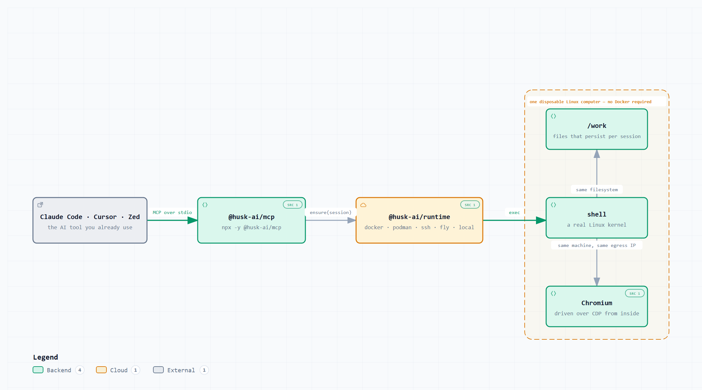
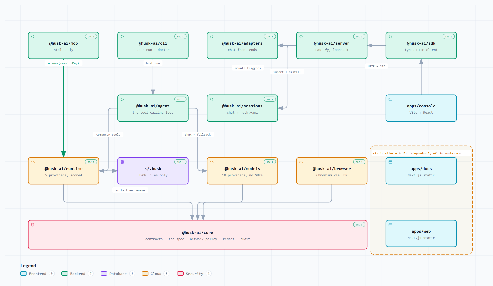
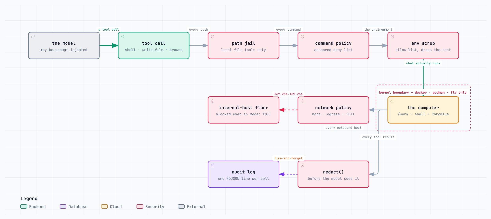

<div align="center">
  <picture>
    <source media="(prefers-color-scheme: dark)" srcset="brand/logo/lockup-horizontal.svg">
    <source media="(prefers-color-scheme: light)" srcset="brand/logo/lockup-horizontal.svg">
    
  </picture>

  <p><strong>Your AI chat gets a computer.</strong></p>
  <p>A terminal, files and a browser it can actually use, and a workspace that keeps what it finds for next time.</p>

  <p>
    <a href="https://github.com/Hotragn/husk/actions/workflows/ci.yml"></a>
    <a href="https://www.npmjs.com/package/@husk-ai/cli"></a>
    
    <a href="LICENSE"></a>
  </p>
</div>

Husk gives your AI chat named local workspaces. Save public web sources, ask your AI
for a cited brief, comparison, or action list, then review and download the result.
Reopen the same workspace in your next chat. No Husk account, Docker, terminal, or
additional model API key is needed for this starter flow.

For coding and automation, Husk also provides optional computer tools: a shell,
files, and a browser. Existing MCP and CLI computer workflows remain available.

> [!NOTE]
> **0.2.0 public preview.** Download the unsigned desktop extension from the
> [GitHub prerelease](https://github.com/Hotragn/husk/releases/tag/preview-0.2.0).
> It has passed automated checks; installation and first-task completion inside
> Claude Desktop still need beta testing. See the
> [one-day delivery and launch checklist](docs/one-day-delivery.md).

## Start with a workspace

Download `husk-0.2.0.mcpb` from the [public preview](https://github.com/Hotragn/husk/releases/tag/preview-0.2.0).
Install it in Claude Desktop through **Settings → Extensions
→ Advanced settings → Install Extension**. Claude Desktop supplies Node.js. This
candidate is unsigned; organization policies may restrict custom extensions.

Ask Claude: **“Create a Husk workspace called My first brief and open its viewer.”**
Add public page URLs, choose a starter prompt, paste it back into Claude, then return
to review and download the saved result. Keep Claude running while the viewer is open.

The [workspace guide](apps/docs/content/start/workspaces.mdx) explains the full flow,
privacy, recovery, and limits. To build the installer as a contributor:

```bash
npm ci
npm run build
npm run bundle:mcpb
npm run smoke:starter -- --bundle
```

The artifact and checksum are written to `build/`. The smoke test extracts that
archive and checks restart persistence, access control, assets, downloads, and ZIP export.

<picture>
  <source media="(prefers-color-scheme: dark)" srcset="docs/diagrams/png/01-hero.dark.png">
  
</picture>

<sub>[Open interactively](docs/diagrams/01-hero.html) — pan, zoom, trace relationships · [SVG](docs/diagrams/svg/01-hero.light.svg) · [all 16 diagrams](docs/diagrams/)</sub>

## Computer tools for developers

```bash
npx @husk-ai/cli@~0.2 setup
```

`setup` asks where your chats' computers should run (Docker, Podman, this machine, SSH or
Fly, with the reason any of them is unavailable and its fix), adds Husk to the chat apps
it finds (Claude Desktop, Claude Code, Cursor, VS Code, Windsurf, Zed, Codex, Gemini CLI),
and starts the one Husk every chat goes through, printing its console link. It backs up
each app's config file before changing it and touches only its own `husk` entry.
`--remove` takes it out again. The console's **Connect** page does the same. What each
app supports, and how Husk was checked against it, is in
[docs/clients.md](docs/clients.md).

Coming from 0.1.4? Run setup again, or **Update** on the Connect page. Each chat app's
`husk` entry moves to this release and keeps the flags and env you gave it, Claude Code's
per-project entries included (`claude mcp add` writes those by default). Your computers,
the named sessions bound to them, their files and your bots carry over as they are.

**claude.ai and ChatGPT** run in someone else's data centre, so they reach Husk through a
tunnel you run, or a Fly app of your own: `husk serve --remote --public-url https://<name>`.
It is for you alone (a claim code once, then your passkey), and every command, file
change, click, typed text, upload and script waits for your passkey; reading pages and
files does not. Who can read what, the tunnels and the off switch are in the
[remote access guide](apps/docs/content/guides/remote-access.mdx).

> [!NOTE]
> `setup`, the shared Husk and the console's Connect page are on `main` and not yet
> published: npm has 0.1.4. Until the next release, run it from a checkout with
> `npm ci && npm run build && node packages/cli/dist/bin.js setup`.

Once the next release is on npm, you can let the chat do it. Paste this into Claude Code,
Codex, Gemini CLI, Cursor or any chat that can run a command (the Connect page makes one
for a single app). Until then the `npx` line in it fails, because npm has no 0.2 yet: use
the checkout command above instead.

```text
Set up Husk for me, so you get a computer of your own for tasks: a terminal and a real browser, kept apart from my files.

1. Run this in a terminal:
   npx -y @husk-ai/cli@~0.2 setup --computer auto --apps all --yes
   It picks the safest computer this machine can run (a Docker container if Docker is installed) and adds Husk to my chat apps. If you can't run terminal commands, show me that line and I'll run it.
2. Tell me to restart my chat apps so the Husk tools load.
3. Tell me that if the Husk desktop app is installed, it shows your computer in a small window and I can take over any time.

After the restart: call computer_info, open https://example.com in the browser, and tell me what you see.
```

A desktop app (`apps/desktop`) carries the same Husk with its own Node and keeps each
chat's computer one click away: a very small 3D computer for each in the bottom-right
corner, which names its chat app when you hover it. Click one and a compact Computers
window opens, its tabs your computers (each with its chat app's logo), the browser
live on a white screen, Take over a click away. Minimize it and it goes to a notch at
the top of the screen (around the real notch on a Mac). It sits in the tray to tell you
when a chat is waiting for you. Each release attaches its installers for Windows, macOS
and Linux, signed and notarized once the release has the signing keys and unsigned until
then; see [apps/desktop](apps/desktop/README.md).

To add Husk to one app by hand instead:

```bash
claude mcp add husk -- npx -y @husk-ai/mcp
```

That is the whole setup. Nothing is created until the first tool call, so an installed
husk that nobody uses costs nothing. Works with Cursor, Zed, or anything else that
speaks MCP.

In Claude Code you can install it as a plugin instead, which adds a `husk` skill that
teaches the model when to use which tool and when to hand the computer to you:

```text
/plugin install husk --marketplace Hotragn/husk
```

The default computer profile exposes eight workspace tools plus 26 computer tools.
Eight are for the machine — `shell`, `read_file`, `write_file`,
`edit_file`, `list_dir`, `expose_port`, `browse`, `computer_info` — fifteen
`browser_*` tools that drive a real Chromium inside that same machine, addressed by
accessibility ref rather than pixel coordinates, `hand_off` / `hand_off_done`,
which give you the computer for a login, a 2FA code or a CAPTCHA and give it back
only when you say you're done, and `computer_open_ui`, which gives the chat a link
to show you the computer. Apps that render MCP Apps cards also get the card's two
tools. Apps that give up on a long tool call get `job_wait`: Husk answers such an app
before it gives up, saying the call is still running, and `job_wait` collects the result.

The first tool result says what kind of machine it got. A model that thinks it is
sandboxed when it is not makes worse decisions than one that knows.

Every chat on the machine goes through one shared Husk, started on the first tool call,
so `husk serve`'s console shows each chat's computer, its live browser and what it did
last, and takes over a handoff from any of them. `HUSK_DAEMON=off` keeps a chat's tools
in its own process.

## The CLI

```bash
npx @husk-ai/cli onboard                 # guided setup, five steps, start here
npx @husk-ai/cli doctor                  # or go straight to what this machine can offer
npx @husk-ai/cli up dev --flavor python  # bring up a Linux computer
npx @husk-ai/cli exec dev -- 'uname -sr && python3 -V'
npx @husk-ai/cli rm dev                  # tear it down
```

`onboard` names your provider and how isolated it really is, creates a computer and
destroys it in front of you, points at the shortest route to a model if you have none,
and prints the MCP line for your editor. It never asks for an API key — husk reads
credentials from the environment and does not store them, so it prints the `export` line
and re-checks.

On Windows `cmd.exe`, use double quotes -- it does not strip single ones, so the
quotes would reach the container as part of the command:

```bat
npx @husk-ai/cli exec dev -- "uname -sr && python3 -V"
```

`--flavor python` is there because the default `base` flavour is
`debian:bookworm-slim`, which has no `python3` -- and a quickstart whose third line
prints `python3: not found` is not a quickstart. On a laptop with Docker running, that
sequence prints `Linux 6.18.33.2-microsoft-standard-WSL2` and `Python 3.12.14`; with
Docker stopped and WSL2 installed it picks `local` and prints the same kernel with the
distro's own `Python 3.14.4`. `doctor` reports every provider it probed, which one it
would pick, and why the others were skipped.

## Turn a chat into a bot

A conversation that worked once becomes a file you can run again.

```bash
husk import                          # lists transcripts it found
husk import --pick 1                 # imports one, prints its id
husk distill <id> --out triage.yaml  # conversation → agent spec
husk run triage.yaml "check the build"
```

Importers read Claude Code JSONL, Codex rollouts, ChatGPT, Cursor, Gemini and markdown
into one `Transcript`. In the console, **Husks › Make a bot from a chat** does the same
from a chat it finds on this computer, an export, or pasted text. A branched Claude Code
thread is rebuilt along its longest `parentUuid` chain, the latest leaf breaking a tie, so
the dead ends you backed out of are left out. The distiller runs with no API key at all,
and the model-backed mode falls back to that free path rather than failing. Secrets are
stripped before the file is written, not after.

What comes out is YAML you can read and diff:

```yaml
name: triage
model: sonnet
persona: |
  You triage CI failures for a TypeScript monorepo.
  Always read the failing job log before guessing.
tools: [computer, files]
computer:
  flavor: node
  network: { mode: egress, allow: ['github.com', '*.github.com', '*.githubusercontent.com'] }
limits: { maxSteps: 24, maxCostUsd: 0.25 }
```

`husk distill` prints its confidence and everything it could not work out, so a thin
transcript announces itself instead of producing a plausible-looking persona nobody
checks. Five worked examples live in [`examples/`](examples/).

A bot runs on Husk's own engine, on any model, or on your own Claude Code or Codex,
headless under your own login, with Husk's tools and nothing else:

```yaml
engine:
  type: claude-code   # or codex; builtin is the default
  resume: <session>   # Claude Code: go on with that chat, on its computer
```

From a Claude Code chat, the console's **Make this a bot** sets this up when Claude Code
is installed, so the bot is that chat going on; a Codex chat runs on Codex when Codex is
installed. The
[husk.yaml reference](apps/docs/content/chat-to-bot/husk-yaml.mdx#engine) has the details.

## What is in it

- **A machine, not an interpreter.** Files, a shell, ports, a browser. `/work` survives
  the whole session, and `persist` keeps it past that.
- **Five computer providers.** `docker`, `podman`, `ssh`, `fly`, `local`. One interface;
  `auto` takes the highest available.
- **Eleven model providers.** Ollama, Anthropic, OpenAI, Google, Groq, DeepSeek,
  Cerebras, OpenRouter, Mistral, Together, LM Studio. Aliases resolve across all of
  them, so one `husk.yaml` runs on Opus or on a local Gemma.
- **Four adapters.** Discord, Slack, Telegram, webhook.
- **No product telemetry.** The installed runtime has no analytics, crash reporter,
  or version ping. The marketing and documentation websites use Vercel Web Analytics.
- **No native modules.** `npm install` finishes on Windows with no C++ toolchain. Node
  20.10 or newer.
- **Automated regression tests and archive smoke checks.** `npm test` checks the
  packages; integration cases that need an unavailable provider are explicitly skipped.

## How it works

<picture>
  <source media="(prefers-color-scheme: dark)" srcset="docs/diagrams/png/02-system-architecture.dark.png">
  
</picture>

Thirteen packages and five apps. Dependencies run downhill: core imports nothing from
the workspace, every other package except `console-assets` (the built console, no code)
imports it, and nothing imports `@husk-ai/cli`.

```
packages/
  core         contracts, husk.yaml schema, primitives
  runtime      computer providers: docker, podman, local, ssh, fly
  models       one surface over eleven model providers
  sessions     transcript importers + the distiller
  browser      Chromium lifecycle and CDP automation
  agent        tool-calling loop and built-in tools
  adapters     Discord, Slack, Telegram, webhook
  mcp          MCP server (stdio), and the shared Husk every chat forwards to
  server       control-plane API + bot host
  sdk          typed client for the control plane
  workspaces   named local workspaces: sources, results, export
  console-assets  the built console, served by server
  cli          the husk command
apps/
  console      dashboard: live terminal, files, browser
  desktop      the desktop app: corner, Computers window, notch, tray
  mac          Husk Bar, a macOS menu-bar companion
  docs         documentation site (Next.js + MDX)
  web          marketing site (Next.js + Three.js)
```

`server` declares `@husk-ai/agent` but reaches it through a dynamic import, so the
control plane still starts on a tree where the agent was never built.

Four flavours choose the image: `base`, `python`, `node`, `full`. Husk publishes none of
its own. `base` is `debian:bookworm-slim`, `python` is `python:3.12-slim`, `node` is
`node:22-slim`, and `full` is Playwright's image, which already carries the twenty-odd
shared libraries Chromium links against. An image you publish is an operating system you
have promised to keep patched, and Debian and the Playwright team already do that better.
Set `HUSK_REGISTRY` to point the lot at your own mirror.

<sub>[Open interactively](docs/diagrams/02-system-architecture.html) · [SVG](docs/diagrams/svg/02-system-architecture.light.svg)</sub>

## Providers

`auto` walks the ladder and takes the highest rung that answers. Every rung is free
except `fly`, which is metered, so `auto` leaves it out: pick it with `--provider fly`,
or set `HUSK_AUTO_FLY=1` to let `auto` choose it. An explicit `--provider` that turns
out to be unavailable is an error, never a quiet downgrade to weaker isolation.

| Provider | Priority | Isolation | Cost | Notes |
| --- | --- | --- | --- | --- |
| `docker` | 20 | Kernel namespaces, cgroups, seccomp, read-only root | Free | Default when the daemon is up |
| `podman` | 18 | Kernel, rootless | Free | Linux without Docker |
| `ssh` | 16 | Whatever the remote gives you | Free if you own the box | An Oracle Always Free instance, a Pi, a VPS |
| `fly` | 14 | microVM | Metered | Bursty parallel work |
| `local` | 10 | **Guardrails only** | Free | WSL2 gives real Linux; POSIX runs your own shell with guardrails |

> **The `local` provider is not a sandbox.** It stops accidents, not adversaries.
> `husk doctor` reports `isolated: false` for it, and the first MCP tool result says so
> again.

## Security model

<picture>
  <source media="(prefers-color-scheme: dark)" srcset="docs/diagrams/png/05-trust-boundaries.dark.png">
  
</picture>

These hold in every mode, `local` included, and were re-checked against a live `local`
and a live `docker` computer for 0.1.4: the command deny list, the environment scrub,
output caps and process-tree kill. The computer tools also pass every result through
`redact()` and every call through `audited()`. The workspace tools, hand-offs and
`job_wait` are not audited.

The path jail is not one of them, and this paragraph used to say it was
([#120](https://github.com/Hotragn/husk/issues/120)). It is a control on `local` and
`ssh`, where no container stands behind it, and there it confines the file tools rather
than the shell. On `docker`, `podman` and `fly` the container *is* the boundary, so the
file tools address the container's own filesystem: `read_file /etc/passwd` returns the
container's copy, and `/dev/shm` takes a write. Neither reaches your machine, which is
the point of running those providers — a jail inside a kernel boundary is largely
redundant. Claiming one anyway is exactly what this section exists not to do.

What `local` does not give you is a kernel boundary. It shares your kernel, your network
and your user account.

Husk's own tools and the browser's page loads refuse `169.254.169.254` even under
`network.mode: full`, because `full` means the internet and not the cloud metadata service
that hands IAM credentials to whatever asks. The RFC1918 ranges are the same problem one
hop out, and so is loopback, except on Docker, Podman and Fly, where the computer has a
loopback of its own. An operator who wants one of them names it in `allow`, where a
reviewer reading the `husk.yaml` can see the decision.

That check is not a firewall. A shell command is not held to it: in a computer,
`curl http://169.254.169.254/` reaches the address wherever the computer can route to it.
Only `network.mode: none` on Docker or Podman, which gives the container no network at
all, stops a process. The [security model](docs/SECURITY-MODEL.md#network-policy) has
the matrix.

Address spellings are normalised first. `127.1`, `2130706433` and `0x7f000001` are all
`127.0.0.1` to curl, to Chromium and to Python's urllib, so a rule that only understands
four dotted octets is not a rule.

<sub>[Open interactively](docs/diagrams/05-trust-boundaries.html) · [SVG](docs/diagrams/svg/05-trust-boundaries.light.svg)</sub>

## Documentation

- **[Architecture](docs/ARCHITECTURE.md)** — why it is shaped this way
- **[API reference](docs/API.md)** — the control-plane HTTP contract
- **[Build contract](docs/BUILD-CONTRACT.md)** — conventions every package obeys
- **[Security model](docs/SECURITY-MODEL.md)** — what is isolated and what is not
- **[Benchmark](docs/BENCHMARK.md)** — Husk's browser tools against Playwright MCP, measured in CI
- **[Examples](examples/)** — five `husk.yaml` recipes and an MCP session demo
- **[Diagrams](docs/diagrams/)** — 16 interactive architecture, dataflow and design diagrams

## Status

Alpha, pre-1.0. The `husk.yaml` schema and the HTTP contract can still change between
releases. What is known not to work today:

- **On container providers the rendered browser needs the `full` flavor.** CI drives
  the fifteen `browser_*` tools on Docker with `full` (Playwright's image, which carries
  Chromium's libraries). The slim flavors cannot run Chromium: their root filesystem is
  read-only, so the libraries cannot be added later. `base` (`debian:bookworm-slim`) has
  neither curl nor python3, so even `browse` fails there. Chats get `full` unless told
  otherwise (`npx @husk-ai/mcp`, `husk mcp`, remote access, and `husk setup` unless you
  answer no to the browser). `husk up` and a `husk.yaml` default to `base`: pass
  `--flavor full`, or set `computer.flavor: full`.
- **`fly` is the least exercised provider.** It has tests. It has far fewer real hours
  than `docker` and `local`.

## Development

```bash
git clone https://github.com/Hotragn/husk.git && cd husk
npm install
npm run build
npm test
```

## Contributing

Contributions are welcome. [CONTRIBUTING.md](CONTRIBUTING.md) covers the build contract,
the test requirements, and how to add a provider or a model.

## Contributors

Everyone who has shipped something here is on the
[contributors graph](https://github.com/Hotragn/husk/graphs/contributors), which counts
commits rather than asking anyone to remember to add a name.

## License

[Apache-2.0](LICENSE)
